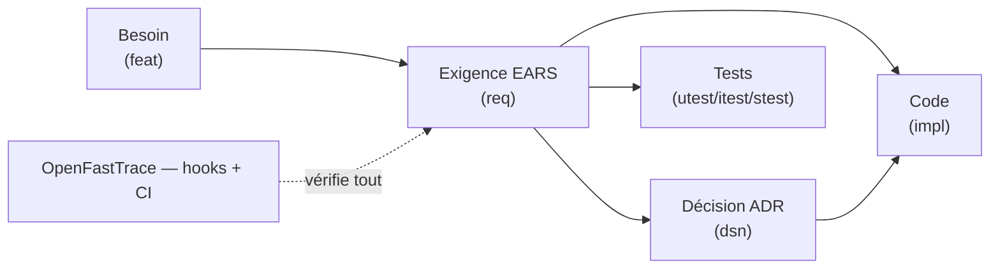

# alm-forge

**Dépôt-gabarit ALM : du besoin exprimé aux tests mécanisés, agnostique du
langage et de l'agent.**

[English summary](README.en.md)

alm-forge instancie en quelques minutes un projet où chaque ligne de code sait
pourquoi elle existe : besoins tracés, exigences rédigées sans ambiguïté
(EARS), décisions actées et protégées (ADR), traçabilité vérifiée
mécaniquement par [OpenFastTrace](https://github.com/itsallcode/openfasttrace)
en local et en CI, tests reliés aux exigences qu'ils prouvent. Le gabarit
s'applique sa propre méthode : sa spécification, ses ADR et sa traçabilité
verte sont la démonstration.

Il capitalise les pratiques éprouvées de deux dépôts de référence (ergonomia,
wallos-rs) et les référentiels du domaine : [MADR](https://adr.github.io/madr/),
[EARS](https://alistairmavin.com/ears/),
[Keep a Changelog](https://keepachangelog.com/fr/1.1.0/),
[Conventional Commits](https://www.conventionalcommits.org/fr/v1.0.0/).

## La chaîne

Chaque relation est déclarée dans les fichiers et vérifiée par l'outil : une
exigence sans test, un tag vers un identifiant inexistant ou une décision
manquante font échouer le commit et la CI. Aucune matrice tenue à la main.

## Arborescence

| Chemin | Contenu |
| --- | --- |
| `docs/methode/` | La méthode, 9 chapitres normatifs |
| `docs/adr/` | Registre des décisions d'architecture |
| `docs/decisions/` | Relevés de séance et registre chronologique |
| `spec/01-besoins/` | Expressions de besoin (items feat) |
| `spec/02-exigences/` | Exigences EARS (items req) |
| `spec/open-questions.md` | Registre des blocages en attente d'arbitrage |
| `templates/fr/`, `templates/en/` | Modèles d'artefacts bilingues |
| `tools/`, `.githooks/`, `justfile` | Portes qualité locales |
| `.github/workflows/ci.yml` | Les mêmes portes en CI |
| `examples/demo-multi-langages/` | Chaîne complète en Python, Rust et shell |
| `AGENTS.md` | Contrat de travail, humains et agents IA |

## Démarrer un projet

1. Cloner (ou « Use this template » sur GitHub), renommer.
2. `just hooks` puis `just ci` — tout doit être vert avant la première ligne.
3. Vider `spec/01-besoins/` et `spec/02-exigences/` de la spécification du
   gabarit, y écrire vos besoins (modèles dans `templates/`).
4. Archiver les ADR du gabarit qui ne vous concernent pas (statut Déprécié),
   écrire l'ADR-0001 de votre projet.
5. Étendre `tools/oft.sh` (périmètre scanné) et la CI aux répertoires de votre
   code, ajouter vos portes propres (lint, couverture, sécurité) — toute porte
   documentée est câblée, ou marquée « non câblée » avec raison et échéance.

## Commandes

| Commande | Effet |
| --- | --- |
| `just trace` | Traçabilité complète (échoue si un maillon manque) |
| `just report` | Rapport HTML navigable dans `build/` |
| `just check` | Cohérence : ADR acceptés, parité des templates, version |
| `just ci` | Tout ce que la CI exécute |
| `just adr-new titre` | ADR suivant depuis le modèle |
| `just hooks` | Installe les hooks git |

Prérequis : git, just, bash, curl, Java 17+.

## Licence

[MIT](LICENSE).
